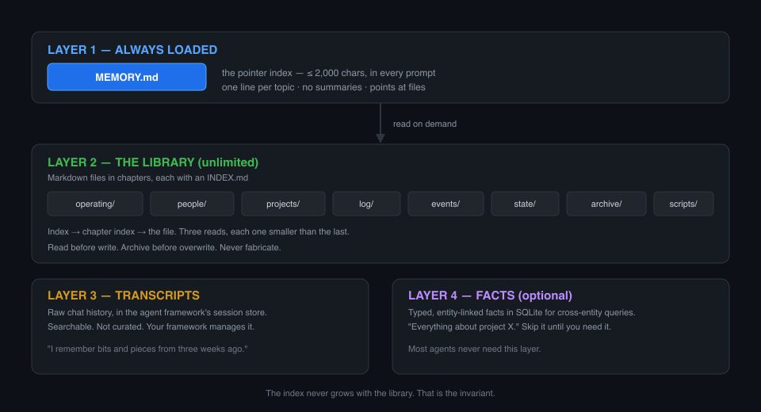

# ai_agent_memory

<p align="center">
  
</p>

**A long-term memory library for AI agents.**

An agent that forgets everything between sessions isn't an agent — it's a
stateless completion endpoint with amnesia. This is a working, portable
structure for giving one a durable memory: plain Markdown files, one
index, no database required.

The core idea is small:

> **One index file. One pointer per topic. Everything else lives in a
> file somewhere. The index is a table of contents, not a journal.**

<p align="center">
  
</p>

---

## Why this exists

Most agent frameworks give you one of two bad options:

**Option A — one big memory blob.** A single file you keep appending to.
It works for a week. Then it's 40,000 characters of stale notes, half of
it contradicted by later entries, and no way to find anything. It also
blows past the context window on every single request.

**Option B — a vector database.** Great for retrieval, terrible for
*maintenance*. Nobody can read it, hand-edit it, diff it in git, or
explain why the agent believes something. And it still doesn't tell you
*where* a fact came from.

This is **Option C**: a file-based library with a strict pointer
convention. It's boring, git-friendly, human-editable, agent-editable,
and it scales to tens of thousands of files.

### The three rules

Everything else is detail. These three rules are what make it work:

1. **The index is a pointer index, not a journal.**
   If a fact needs more than one line in the index, the fact belongs in
   a file and the index gets a pointer to it.

2. **Read before write, every time.**
   Never overwrite a file you haven't just read. You don't know what's in
   it, and the file may have changed since you last looked.

3. **Archive, never delete.**
   When a file changes materially, copy the old version into `archive/`
   first. Memory that's wrong is still memory — it records what you
   believed and when.

---

## Table of contents

- [The architecture](#the-architecture)
- [Repository layout](#repository-layout)
- [The index](#the-index)
- [Chapters](#chapters)
- [How an agent uses it](#how-an-agent-uses-it)
- [Setting it up in your own environment](#setting-it-up-in-your-own-environment)
- [Scripts](#scripts)
- [The starter template](#the-starter-template)
- [Conventions](#conventions)
- [Auditing](#auditing)
- [FAQ](#faq)
- [License](#license)

---

## The architecture

Four layers. Each has a job, and **they don't substitute for each
other**.

| Layer | What it is | Where it lives | Size |
|---|---|---|---|
| **1. Index** | The always-loaded pointer table | `MEMORY.md` | ≤ 2,000 chars |
| **2. Library** | The long-form memory — rules, projects, people, logs | `library/` | Unlimited |
| **3. Transcripts** | Raw conversation history | your agent's session DB | Unbounded |
| **4. Facts** | Structured entity relations | SQLite (optional) | Unbounded |

### Layer 1 — the index

A small file, loaded into context on every turn, containing one pointer
line per topic:

```markdown
## Read order
**Cold-start:** MEMORY.md → library/operating/RULES.md → library/operating/SELF.md → INDEX.md → the file inside.

Standing rule: archive before overwrite (RULES §2). See library/operating/RULES.md.
```

That's it. It doesn't contain the *content* of anything. It's the page
numbers in a book.

**Why the size limit matters.** The index is in every prompt, so every
character in it is paid for on every request. Keeping it small is what
lets the actual knowledge live somewhere unlimited.

### Layer 2 — the library

Markdown files organized into chapters. Each chapter has an `INDEX.md`
that lists its files with a one-line description, so the agent can find
the right file without listing the directory.

```
library/
├── INDEX.md              ← master index; points at each chapter
├── operating/            ← rules, identity, environment, projects map
│   ├── INDEX.md
│   ├── RULES.md          ← durable operating discipline
│   ├── SELF.md           ← who the agent is
│   ├── ENVIRONMENT.md    ← machine-specific facts
│   ├── PROJECTS_INDEX.md ← map of every project
│   ├── learning/         ← notes on what it's learned
│   ├── research/         ← open research threads
│   └── reflections/      ← the agent's own thinking
├── people/               ← one file per person
├── projects/             ← one directory per project
├── log/                  ← append-only daily logs
├── events/               ← significant incidents, dated
├── state/                ← current state, open loops, priorities
├── archive/              ← old versions, never deleted
└── scripts/              ← helper scripts
```

### Layer 3 — transcripts

Raw chat history, usually in the agent framework's own session store
(SQLite + FTS5 for most frameworks). This is the "I remember bits and
pieces from three weeks ago" layer — searchable, but not curated.

You don't manage this. Your framework does.

### Layer 4 — facts (optional)

A small SQLite table of typed, entity-linked facts for structured
recall: "tell me everything about project X", "what do we know about
person Y".

**This is the layer most people skip, and it's fine to skip it.** The
first three layers carry an agent perfectly well. Facts earn their place
when you need to *query across entities* rather than read a file.

---

## Repository layout

This repo is the library **plus** the tooling to maintain it.

```
ai_agent_memory/
├── README.md               ← you are here
├── MEMORY.md               ← the index (Layer 1) — copy this into your agent's memory
├── INDEX.md                ← the library's master TOC
├── docs/
│   ├── SETUP.md            ← how to stand this up in your own environment
│   ├── ARCHITECTURE.md     ← why it's shaped this way
│   ├── WRITING.md          ← how to write memory files that stay useful
│   └── CONVENTIONS.md      ← naming, headers, frontmatter
├── library/                ← the actual memory structure (Layer 2)
│   └── ...chapters...
├── scripts/
│   ├── memory_note.sh      ← append a timestamped note to today's log
│   ├── memory_append.sh    ← append a typed event to today's log
│   ├── memory_snapshot.sh  ← append a periodic state snapshot
│   ├── build_index.py      ← regenerate a chapter's INDEX.md
│   └── audit_memory.py     ← check the library's health
└── template/               ← starter files to copy
    ├── RULES.md
    ├── SELF.md
    ├── ENVIRONMENT.md
    ├── PROJECTS_INDEX.md
    ├── people/
    ├── projects/
    └── events/
```

**Why the library is a separate directory from the tooling.** The
library is what you'd want to sync, back up, or copy into another
agent. The scripts are what you'd want to install once. Keeping them
apart means you can deploy the same library to several agents without
dragging tooling along.

---

## The index

`MEMORY.md` is the always-loaded pointer file. It has three parts:
**header**, **pointers**, **footer**.

```markdown
## Read order
**Cold-start:** MEMORY.md → library/operating/RULES.md → library/operating/SELF.md → INDEX.md → the file inside.

Standing rule: archive before overwrite. See library/operating/RULES.md.

Project map: library/operating/PROJECTS_INDEX.md.

Session history: library/log/2026-01-15.md
```

### The test for whether something belongs in the index

> If it needs more than one line here, it belongs in a file.

That's the whole rule. A pointer that summarizes its target is a
paraphrase of the target, and paraphrases drift. Point at the file; let
the reader open it.

### The size budget

| Target | Hard ceiling | What happens past it |
|---|---|---|
| 2,000 chars | 4,000 chars | The index is in every prompt. Past the ceiling it's actively harmful — it crowds out the conversation. |

If you're at the ceiling, **you have too much in the index**, not too
little space. Move content into the library and leave a pointer.

### Common failure mode

> *"I want this at cold-start, so I'll add it to the index."*

If it's worth having at cold-start, it's worth having **as a pointer**.
The index isn't a summary of your memory; it's the address of your
memory. Every prose recap you add there is a thing that can drift out of
sync with the file it describes.

---

## Chapters

Each chapter is a directory with an `INDEX.md`. The chapter index is a
**map, not a dump**:

```markdown
# PROJECTS — chapter index

**Chapter root:** `library/projects/`
**Purpose:** One directory per project.

| Project | What it is | Status |
|---|---|---|
| `voice_bridge/` | Mobile full-duplex voice UI | live |
| `radio_stack/` | P25 trunking for the local repeater | live |
```

One-line summaries. Status flags. Enough to decide *which file to open*
without opening any of them.

### The chapters

| Chapter | Holds | Lifetime |
|---|---|---|
| `operating/` | Rules, identity, environment, the project map | Long-lived |
| `people/` | One file per person the agent knows | Long-lived |
| `projects/` | One directory per project — plans, decisions, code | Long-lived |
| `log/` | Append-only daily logs, one per day | Append-only |
| `events/` | Significant incidents, dated and slugged | Long-lived |
| `state/` | Current state, open loops, priorities | Rewritten often |
| `archive/` | Superseded versions of everything | Never deleted |
| `scripts/` | Maintenance helpers | Long-lived |

**`log/` vs `events/`** is the distinction people get wrong:

- **`log/`** — what happened today. Texture. Append-only, one file per
  day, written as the day unfolds. "We tried X, it broke, we moved to Y."
- **`events/`** — something significant enough to be *found later*. A
  postmortem, an architecture decision, a security incident. Dated,
  slugged, and referenced from the index.

A day that had no events still gets a log file. An event that spans days
gets one event file.

---

## How an agent uses it

### Cold start

```
1. Load MEMORY.md                     (the index — already in context)
2. Read library/operating/RULES.md    (how to behave)
3. Read library/operating/SELF.md     (who you are)
4. Read library/operating/STATE.md    (what's happening now, if present)
5. Read the chapter INDEX.md for whatever the task touches
6. Read the file inside it
```

Steps 5 and 6 are the whole point of the chapter indices. An agent
should be able to answer "what do I know about project X?" by reading
one index file and one project file — not by grepping the whole library.

### During a session

| Situation | Action |
|---|---|
| Something happened today | Append to `log/<today>.md` |
| Something significant happened | Write `events/<date>_<slug>.md`, add a pointer |
| A durable rule was learned | Add to `operating/RULES.md` |
| The user asked "do you remember X?" | `library/` first, then transcripts, then facts |
| A project advanced | Update the project file, update its row in `PROJECTS_INDEX.md` |
| You're about to overwrite a file | Read it, archive it, then write |
| You're about to remember a small detail | Ask: does it need a pointer in the index, or nothing at all? |

### The write path

```python
# 1. Read the target first. Always.
content = read_file(target)

# 2. Does it exist already? If you're materially changing it, archive.
if materially_changed and target.exists():
    copy(target, f"archive/{today}_{slug}/{target.name}")

# 3. Write.
write_file(target, new_content)

# 4. If the change should be findable from the index, add a pointer.
#    One line. No summary.
```

### The recall path

```python
# 1. Index first — it's small and always loaded.
# 2. Chapter index — small, tells you which file.
# 3. The file.
# 4. Only then: transcripts, then structured facts.
```

**Order matters.** Starting with a full-text search over the whole
library returns 200 hits and teaches you nothing. Start narrow and widen.

---

## Setting it up in your own environment

See **[docs/SETUP.md](docs/SETUP.md)** for the full walkthrough. The
short version:

```bash
git clone https://github.com/DuNorth595/ai_agent_memory.git
cd ai_agent_memory

# 1. Copy the library wherever you want it to live.
cp -R library ~/my-agent-memory

# 2. Copy the starter files over the empty ones.
cp template/operating/*.md ~/my-agent-memory/operating/
cp template/people/*.md ~/my-agent-memory/people/ 2>/dev/null || true

# 3. Point your agent's memory index at your library.
#    Most frameworks have a memory file the agent loads every turn.
#    Copy MEMORY.md there and adjust the paths.

# 4. Make the scripts work.
export MY_MEMORY_ROOT=~/my-agent-memory
scripts/memory_note.sh "first note"
```

### Adapting the paths

Everything is relative to the library root. The scripts read
`$MY_MEMORY_ROOT` (or default to `./library` relative to the repo), so
you can point them anywhere.

### Adapting to your framework

This structure is framework-agnostic. It works with anything that can
read files and run shell commands:

| Framework | How to wire it up |
|---|---|
| Hermes | Set the agent's memory pointer to `MEMORY.md`; use the `memory` tool for the index and the filesystem for the library |
| Claude Code | `CLAUDE.md` → point at `MEMORY.md`; skills for procedures |
| OpenAI Agents SDK | A `FileSearch` tool over the library; `MEMORY.md` in the instructions |
| Anything custom | Load `MEMORY.md` into the system prompt; give the agent read/write tools over `library/` |

---

## Scripts

All four are plain shell/Python with no dependencies beyond the
standard library.

### `memory_note.sh` — append a timestamped note

```bash
scripts/memory_note.sh "Fixed the barge-in threshold"
```

Appends `- 14:32 Fixed the barge-in threshold` to today's log.

### `memory_append.sh` — append a typed event

```bash
scripts/memory_append.sh DECISION "Switched to server-side endpointing"
```

Types: `DISCOVERY`, `BLOCKER`, `DECISION`, `ERROR`, `PLAN`, `CONTEXT`,
`BREAKTHROUGH`, `FAILURE`, `TASK`, `USER_REQUEST`.

Creates today's log with a standard section skeleton if it doesn't
exist, then appends `- [14:32:07] [DECISION] ...`.

### `memory_snapshot.sh` — periodic state snapshot

Appends a fill-in-the-blanks state block to today's log. Useful on a
timer — it gives you a breadcrumb trail of "what was the agent thinking
at 3pm" without writing a full log entry every time.

### `build_index.py` — regenerate a chapter index

```bash
scripts/build_index.py library/projects
```

Walks a chapter and writes its `INDEX.md` from each file's frontmatter
description and status. **It never overwrites a hand-written index
without a `--force` flag** — an auto-generated index is a map, but a
human-tuned one is better.

### `audit_memory.py` — health check

```bash
scripts/audit_memory.py
```

Reports:
- index size vs. the 2,000/4,000 char budget
- files in the library that no index mentions (orphans)
- files with missing or stale frontmatter
- archive directories without a `RECOVERY_README.md`
- links in any index that point at files that don't exist

Exit code is non-zero if anything needs attention, so it drops straight
into CI or a cron job.

---

## The starter template

`template/` holds the files you copy to get started:

| File | For |
|---|---|
| `operating/RULES.md` | Durable operating discipline — the rules the agent follows |
| `operating/SELF.md` | Identity, values, what the agent won't do |
| `operating/ENVIRONMENT.md` | Machine facts, paths, quirks |
| `operating/PROJECTS_INDEX.md` | The project map |
| `people/PERSON_TEMPLATE.md` | One file per person |
| `projects/PROJECT_TEMPLATE.md` | One directory per project |
| `events/EVENT_TEMPLATE.md` | One file per significant event |

They're written as working examples, not empty stubs. An agent reading a
blank template learns less than one reading a filled-in example and
modifying it.

---

## Conventions

Full details in **[docs/CONVENTIONS.md](docs/CONVENTIONS.md)**. The
short version:

### File naming

| Kind | Pattern | Example |
|---|---|---|
| Daily log | `YYYY-MM-DD.md` | `2026-01-15.md` |
| Event | `YYYY-MM-DD_snake_slug.md` | `2026-01-15_gateway_restart.md` |
| Project | `snake_case/` | `voice_bridge/` |
| Person | `lowercase.md` | `justin.md` |
| Archive | `YYYY-MM-DD_category/` | `2026-01-15_memory-redesign/` |

### Frontmatter

Every library file carries frontmatter so the index builder can read it
and so a grep for context stays possible:

```markdown
---
title: Gateway restart loop
date: 2026-01-15
type: event
status: closed
tags: [hermes, launchd, incident]
---

# Gateway restart loop
```

### Headers

Every chapter file starts with a three-line header:

```markdown
# TITLE

**Purpose:** one line.
**Owner:** who maintains it.
**Last updated:** YYYY-MM-DD
```

The `Last updated` line is what makes staleness visible during an
audit.

---

## Auditing

Memory libraries rot. The failure modes are predictable, and all of
them are detectable:

| Rot | How it shows | Fix |
|---|---|---|
| Index bloat | Index past 2,000 chars | Move content to the library |
| Orphan files | A file no index mentions | Add a pointer, or delete it |
| Stale pointers | Index names a file that doesn't exist | Fix or remove the pointer |
| Unarchived overwrites | Old version vanished | Restore from archive, add the archive step to your rules |
| Staleness | `Last updated` months ago | Review, or mark it frozen |
| Contradiction | Two files disagree | Pick one, archive the other, note the change in an event file |

Run the audit weekly:

```bash
scripts/audit_memory.py
```

**The most important audit is the one you don't automate:** read your
own rules every few weeks and ask whether you'd still follow them. A
rule you stopped believing is worse than no rule, because the agent
will cite it.

---

## FAQ

**Do I need the transcripts layer?**
No. Skip it if your framework doesn't have one. Layers 1, 2, and 4 are
enough.

**Do I need the facts layer?**
Also no. Most agents never need structured entity queries. Add it when
you find yourself wanting "everything about X" across categories.

**How big should the library get?**
Unlimited. That's the point of splitting it out of the index. A library
of 50,000 files and a 1,500-character index is a healthy system.

**Won't this blow up my context window?**
No — that's what the index is for. The index is small; the library is
read on demand. You only pay context for what you open.

**Should I put everything in one file?**
Only if you're certain it stays under a few thousand characters. The
moment it doesn't, the index discipline becomes impossible to maintain.

**How do I handle a fact that changed?**
Change the file. Archive the old version. Add a pointer to an event file
describing what changed and when. **Never silently overwrite** — the
history of a belief is part of the memory.

**What's the difference between an event and a daily log entry?**
A log entry is "we tried the thing." An event is "we tried the thing,
and here's what we learned, and here's the decision." If a day only
produced log entries, that's fine. Promote to an event when something
is worth finding later.

**Can I use this with multiple agents?**
Yes, and you probably should. Give each agent its own library under
`library/agents/<name>/` with its own index, and share the common
chapters (`operating/`, `people/`) between them. Two agents writing to
one file is a conflict; two agents reading shared files is fine.

**Does this work for a human team?**
Yes — the same structure works as a shared team knowledge base. The
"agent" in the title is just the primary reader.

---

## License

MIT — see [LICENSE](LICENSE).

SPDX-License-Identifier: MIT
